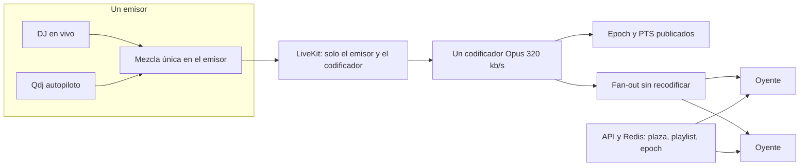

# ADR: una sala de audio para 10.000 oyentes

Estado: **diseño**. No hay código de ejecución nuevo en este cambio. No certifica 10.000, no mide latencia y no da por buena ninguna prueba anterior de R2 o de HLS.

Fecha del texto: 9 de noviembre de 2026.

Depende de que se fusione el PR [#4](https://github.com/patriciomoyano11-rgb/QSession-private/pull/4), rama `cursor/scale-1m-roadmap-4344`. `main` en el momento de escribir esto es `b683c6c07157eb6fcb5cd28a32186ecc09931d9c` (fusión del PR #3). Ese `main` tiene el Worker HLS restaurado y el perfil de vídeo de 6 s. No tiene la admisión cerrada, el aislamiento de staging ni este diseño. Hasta que el PR #4 entre en `main`, este archivo solo existe en esa rama.

## 1. Decisión

Para una silent party, la sala es **una mezcla y una línea de tiempo**, no diez mil sesiones de LiveKit ni diez mil reproductores mezclando cada uno su playlist.

El objetivo de producto, todavía sin medición, es:

- solo audio, de un DJ en vivo o de Qdj en autopiloto;
- una sala lógica;
- 10.000 oyentes simultáneos;
- 320 kb/s como cifra de planificación del flujo único;
- 1–2 s desde la salida del mezclador del DJ hasta el audio que el oyente puede oír, en el camino que de verdad pueda sostenerlo;
- el desfase entre oyentes importa más que bajar otro segundo de latencia media.

Ese 1–2 s **no sale** de acortar el HLS actual. El camino recomendado es un solo codificador y un fan-out que reenvía los mismos paquetes. El HLS con segmentos de segundos enteros queda como alternativa web, con otro objetivo de latencia, escrito más abajo. No es el mismo producto.

## 2. Qué está implementado y qué no

| Pieza | Dónde | Estado |
| --- | --- | --- |
| DJ y Qdj mezclan en el navegador del emisor y publican **una** pista de audio | `platform/public/dj-mixer.js`, `platform/public/tab-capture.js`, `platform/public/music-library.js` | Implementado para el emisor. La mezcla no ocurre en cada oyente. |
| La UI del emisor ofrece 128, 192, 256 y 320 kb/s | `platform/public/tab-capture.js` | Implementado como tope de envío WebRTC del emisor. No es el perfil de la audiencia. |
| Egress escribe HLS MPEG-TS a R2, AAC, y convierte bit/s a kbit/s | `platform/edge-broadcast.js` líneas 107–110 y 245–274 | Implementado. El audio por defecto es **128 kb/s**, acotado entre 64 y 320. El segmento se redondea y se fuerza entre **2 y 10 s**. El código estima la latencia como `segmentDuration * 3`. |
| Perfil ensayado en la operación | `platform/docs/BROADCAST-10000.md` | H.264 1280×720, vídeo 1,6 Mb/s, AAC 128 kb/s, segmentos de **6 s**. El propio documento dice que AAC a 320 kb/s es otro perfil y no está validado. |
| Audiencia `cdn-only` reproduce con hls.js o con el vídeo nativo de Safari | `platform/public/app.js` alrededor de las líneas 6718–6750 | Implementado. hls.js lleva `lowLatencyMode: true` y `liveSyncDurationCount: 2`. Eso no crea partes LL-HLS si el manifiesto no las trae. Con segmentos de 6 s, dos segmentos son unos 12 s de borde. |
| Admisión Redis en cada GET, presupuesto de búfer y rechazo de producción | PR #4, sobre todo `platform/edge/hls-worker.js` y `platform/scripts/load_target_policy.py` | En la rama del PR, no en `main` hasta fusionarlo. No cambia el códec, el segmento ni el reloj del reproductor. |
| Reloj local de tramas de 20 ms | `platform/audio-timeline.js` y `platform/test/audio-timeline.test.js` | Simulador sin red. No mide teléfonos, no mueve audio y no certifica 10.000. |
| Epoch firmado, fan-out, failover con la misma línea de tiempo, medición acústica | — | **No implementado.** |
| 10.000 oyentes estables | `SCALE-1M-ROADMAP.md`, `BROADCAST-10000.md` | **No demostrado.** Las tandas de 10.000 siguen fallidas. La de 1.500 no se reescribe como éxito de capacidad. |

`lowLatencyMode` en hls.js no convierte un manifiesto de segmentos de 6 s en LL-HLS. El Worker tampoco parte los segmentos: `LIVE_OBJECT_PATTERN` admite `.ts` y `.m4s` enteros, no un protocolo de partes.

## 3. Cifras de 320 kb/s

Son payload de audio, sin RTP, sin TLS, sin cabeceras de playlist y sin reintentos.

```text
B = 320 × 10^3 bit/s

Agregado de 10.000 oyentes = 10.000 × B = 3,2 × 10^9 bit/s = 3,2 Gb/s

Bytes por oyente y hora = B / 8 × 3600 = 1,44 × 10^8 bytes = 144 MB decimales

Total de 10.000 oyentes y hora = 1,44 × 10^12 bytes = 1,44 TB decimales
```

Ese agregado es lo que hay que **entregar**, no lo que tiene que **codificar** el origen. Un solo codificador emite unos 320 kb/s. El salto a 3,2 Gb/s aparece donde el flujo se copia hacia los oyentes.

Si cada oyente descarga del origen (R2 o el Worker sin un HIT compartido), el origen ve esos 3,2 Gb/s. Si un CDN o un fan-out intermedio acierta la misma clave, el origen ve un flujo más los fallos de caché. El PR #4 no midió ese HIT a 10.000. La tanda histórica de 10.000 tuvo 503 de admisión y de llenado de caché; sigue fallida.

Peticiones, aparte del ancho de banda:

- HLS de 6 s y sondeo de manifiesto cada 2 s, como el cliente de carga actual: `R = N × (1/2 + 1/6) = N × 2/3`. A 10.000 son unas 6,7 × 10^3 peticiones/s.
- Partes de 200 ms más un reload de playlist: el término de medios pasa a `N / 0,2 = 50.000` peticiones/s, antes de contar el manifiesto. Eso es plano de control, no una mejora automática de sincronía.
- WebRTC con tramas de 20 ms: unos 50 paquetes/s por oyente, 5 × 10^5 paquetes/s hacia 10.000 oyentes, más RTCP. No son peticiones HTTP; sí son cifrado y cola por paquete.

No hay precios en este ADR. Las tarifas supuestas siguen, marcadas como supuesto, en la sección 6 de `SCALE-1M-ROADMAP.md`. No se reutilizan aquí.

## 4. Comparación

### 4.1 HLS actual (segmentos de 6 s, MPEG-TS, AAC)

Es lo que Egress escribe hoy (`SegmentedFileProtocol.HLS_PROTOCOL`, `segmentDuration` de segundos enteros, playlist en vivo `index.m3u8`).

LiveKit documenta `segment_duration` como entero en segundos y el protocolo HLS (TS o fMP4). No documenta `EXT-X-PART`, `EXT-X-PRELOAD-HINT` ni blocking reload. Fuentes: [Egress API](https://docs.livekit.io/reference/other/egress/api/), [salidas de Egress](https://docs.livekit.io/transport/media/ingress-egress/egress/outputs/) y el proto [`livekit_egress.proto`](https://github.com/livekit/protocol/blob/main/protobufs/livekit_egress.proto) (campo `segment_duration` en segundos; `audio_bitrate` en kb/s, defecto 128). No se encontró LL-HLS en esa API. Si una versión posterior lo añade, hay que volver a leer el proto antes de afirmarlo.

Un reproductor que espera de dos a tres segmentos queda a 12–18 s del borde con piezas de 6 s. Coincide con `approximateLatencySeconds = segmentDuration * 3` y con `liveSyncDurationCount: 2`. Bajar el segmento al mínimo que el código acepta (2 s) seguiría en unos 4–6 s de borde de playlist, antes de red, Bluetooth y altavoz. **No cumple 1–2 s.**

El CDN reparte bytes. No alinea relojes. ABR elige calidad; no alinea oyentes. No forma parte de esta decisión.

### 4.2 LL-HLS / CMAF

Apple define partes (`EXT-X-PART`) que pueden publicarse antes del segmento padre. Un ejemplo suyo es una parte de 200 ms y un padre de 6 s. También exige, en la guía para dispositivos Apple:

- la duración de parte debe ser al menos el RTT P95 esperado y **debería** ser al menos tres veces ese RTT;
- la duración recomendada de parte es **1 s**;
- `PART-HOLD-BACK` debe ser al menos **tres** duraciones de parte.

Fuente: [HLS Authoring Specification for Apple Devices](https://developer.apple.com/streaming/hls-authoring-specification-for-apple-devices.html), sección 14, y [Enabling Low-Latency HLS](https://developer.apple.com/documentation/http-live-streaming/enabling-low-latency-http-live-streaming-hls). Safari expone LL-HLS en el reproductor nativo desde iOS 14 ([WWDC20](https://developer.apple.com/videos/play/wwdc2020/10228/)). hls.js puede consumir partes, pero el issue de `EXT-X-PRELOAD-HINT` sigue siendo trabajo aparte; no se auditó la versión vendida en `platform/public`.

Con la recomendación de Apple (parte de 1 s y hold-back de 3 s) el borde de playlist ya son **3 s**, antes de codificar, subir, caché y el grafo de audio del teléfono. Eso queda **fuera** del objetivo de 1–2 s. Partes de 200 ms solo caben en ese objetivo si el RTT P95 del venue es mucho menor que 200 ms y el reproductor no añade otro búfer. En una sala con Wi-Fi o celular compartido, ese RTT no está medido y la propia guía de Apple desaconseja partes tan cortas. Además, LiveKit Egress no emite esas partes. Habría que poner un empaquetador distinto detrás de una ingestión de baja latencia. Ese empaquetador **no existe** en el repositorio.

La misma guía recomienda AAC estéreo entre **32 y 160 kb/s**. Los 320 kb/s aparecen en la tabla de AAC **5.1**, no en la de estéreo. 320 kb/s estéreo es la cifra de planificación pedida; **no** es una recomendación de Apple y no está probado en Safari. Opus no sustituye a AAC en el HLS que Safari reproduce de forma nativa: la guía exige estéreo AAC, HE-AAC o xHE-AAC.

### 4.3 WebRTC / Opus y la topología de LiveKit

Dentro de la sala, el audio del DJ ya viaja por WebRTC. Opus admite hasta 510 kb/s ([RFC 6716](https://www.rfc-editor.org/rfc/rfc6716)); 320 kb/s es legal. El SFU no vuelve a codificar: reenvía. La latencia de un suscriptor cercano puede estar en cientos de milisegundos más el búfer, que es el único camino de los comparados que **puede** acercarse a 1–2 s. Acercarse no es haberlo medido.

Límite de topología, leído en la documentación actual de LiveKit y no en un folleto:

- En auto-hospedaje, **una sala tiene que caber en un nodo**. Varios nodos y Redis reparten **salas**, no los suscriptores de la misma sala. El nodo que recibe al cliente hace de puente de señalización hacia el nodo dueño de la sala. Fuentes: [Distributed multi-region](https://docs.livekit.io/transport/self-hosting/distributed/) y [LiveKit SFU](https://docs.livekit.io/reference/internals/livekit-sfu/).
- El benchmark publicado de “sala de audio grande” es **10 publicadores y 3.000 suscriptores**, a unos **3 kb/s** de media, en una instancia de 16 núcleos, al 80 % de CPU, con unos 23 MB/s de salida. No es música a 320 kb/s ni 10.000 oyentes. Fuente: [Benchmarking](https://docs.livekit.io/transport/self-hosting/benchmark/).
- La tabla de producto dice, para auto-hospedaje, “hasta unos 3.000” usuarios por sala y, para LiveKit Cloud, “sin límite”, con cada usuario en el borde más cercano. Fuente: [Self-hosting overview](https://docs.livekit.io/transport/self-hosting/). “Sin límite” es una afirmación del proveedor. QSession no la ha medido y este ADR no la adopta como capacidad propia.
- El ejemplo de configuración trae `playout_delay` entre 100 y 2.000 ms y `sync_streams`. Fuente: [`config-sample.yaml`](https://github.com/livekit/livekit/blob/master/config-sample.yaml). Sirve para A/V en **una** sala de un nodo. No reparte 10.000 suscriptores.

10.000 suscriptores a 320 kb/s son 3,2 Gb/s de payload solo de salida, unas diecisiete veces el ancho de banda del benchmark de audio y más del triple de suscriptores, con tramas de música en vez de voz a 3 kb/s. No se extrapola en línea recta: cada paquete se cifra. **Poner a los 10.000 oyentes en la sala LiveKit actual no es una arquitectura válida.** LiveKit Cloud podría serlo solo después de un contrato y de una medición; no está contratado ni medido aquí.

Egress de solo audio existe (`audio_only`, y sin `layout` ni `custom_base_url` para no pasar por Chrome). Fuente: [RoomComposite y web egress](https://docs.livekit.io/transport/media/ingress-egress/egress/composite-recording/). El código actual no lo usa: arranca `startTrackCompositeEgress` o `startParticipantEgress` con vídeo H.264 720p cuando hay cámara. Un Egress de solo audio seguiría siendo **un** suscriptor que produce **un** archivo o playlist, no el fan-out de 10.000.

## 5. Arquitectura recomendada

Una sala lógica. Dos planos. Un reloj.



1. **Mezcla una vez, antes de codificar.** Qdj ya cruza pistas en `dj-mixer.js` y publica una salida. Un cambio de playlist, un fundido o un fallo de la pista entrante se oye igual para todos porque ocurre delante del único codificador. Cada teléfono no debe volver a mezclar ni a leer el catálogo para estar en sincronía.
2. **LiveKit se queda pequeño.** Entran el DJ (o el proceso que publique la mezcla) y un suscriptor de codificación. No entran los 10.000 oyentes. Así se respeta el límite de “una sala, un nodo” sin fingir que varios nodos parten la misma sala.
3. **Un codificador.** Opus, 48 kHz, estéreo, 320 kb/s, tramas de 20 ms. Es el flujo canónico. No hay escalera ABR para “arreglar” el desfase: todos los oyentes de la sala consumen este mismo flujo. Un perfil más bajo, si algún día hace falta para un enlace malo, es otra sala lógica u otra línea de tiempo anunciada, no un cambio silencioso a mitad de un tema.
4. **Fan-out que copia paquetes.** Varios procesos de reenvío reciben el mismo RTP (mismo timestamp y la misma secuencia de origen) y lo entregan a subconjuntos de oyentes. Pueden estar en distintas máquinas porque **no** son la sala LiveKit: no negocian una mezcla nueva. 3,2 Gb/s no caben en la VM de Egress de 4 vCPU que describe `BROADCAST-10000.md`. El número de máquinas sale de una medición de paquetes y de CPU, no de dividir 10.000 entre 3.000.
5. **El plano de control no lleva el audio.** Unirse, reservar plaza, anunciar el epoch y ordenar la playlist pasan por la API y Redis. El reproductor no espera un `ZADD` para cada paquete. El PR #4 hace lo contrario en el HLS actual: cada GET renueva la concesión. Ese comportamiento se conserva para el HLS de hoy. El reproductor de esta arquitectura no debe copiarlo al camino de paquetes. Separar los planos es trabajo futuro y no puede volver al modo en el que una variable ausente saltaba Redis: el token puede durar horas y la plaza unos 90 s (`platform/broadcast-admissions.js`, descrito en el PR #4).
6. **Reloj.** El codificador elige un epoch `T0` en milisegundos de una base monótona y lo publica por el plano de control, firmado junto con el identificador de la sala y la generación de la mezcla. El timestamp RTP 0 corresponde a `T0`. Cada paquete `n` de 20 ms corresponde a `T0 + n × 20 ms`. El oyente no usa el reloj de pared de su teléfono como verdad del tema; usa `T0` más el timestamp.

### Contrato del reproductor

Objetivos **propuestos**, no resultados. El laboratorio puede rechazarlos.

| Magnitud | Camino de paquetes, auricular con cable, en laboratorio | Qué no cubre |
| --- | --- | --- |
| DJ → salida del búfer del reproductor | p95 ≤ 2,0 s y p99 ≤ 2,5 s | El altavoz del teléfono, Bluetooth y el delay del sistema operativo |
| Desfase de playhead entre dos oyentes del mismo flujo | p95 ≤ 40 ms y p99 ≤ 80 ms | La diferencia acústica en la sala |
| Búfer objetivo | 200 ms, entre 120 y 300 ms | No es un búfer de HLS de varios segundos |
| Corrección de deriva | Como máximo 0,2 % de estiramiento, solo si el error supera 15 ms durante 1 s | No se tiran muestras para “ponerse al día” |
| Pérdida | Ocultación de una trama. A partir de tres tramas seguidas, el oyente se cuenta como hueco y no se estira el tiempo para disimularlo | No se afirma que el oído no lo note |

Estimación de offset: el reproductor mide el RTT del canal de control con dos intercambios y descuenta la mitad. Eso alinea el playhead con `T0`, no el instante en que el sonido sale del auricular. El RTT de un HTTPS lejano puede equivocarse en decenas de milisegundos; por eso el objetivo de 40 ms es de laboratorio con el mismo tipo de red, no una promesa de campo.

Deriva: si el reloj del dispositivo corre más rápido, el búfer se vacía. Se corrige bajando o subiendo la velocidad de reproducción como máximo un 0,2 % (unos 2 ms por segundo), con un cruce corto, no con un salto. Un click o un cambio de tono perceptible falla la prueba aunque el desfase numérico mejore.

Unión tardía y reconexión: el playhead inicial es `ahora_estimado − 200 ms`, alineado a una frontera de trama. No se empieza en el primer segmento del archivo ni en el minuto 0 de la playlist. Si el hueco de red supera 1 s, se vuelve a anclar al borde en vivo menos 200 ms y se cuenta una discontinuidad. No se acelera el audio un 10 % para recuperar el hueco.

Cambio de playlist: solo en la mezcla del emisor. El epoch de la mezcla no cambia. Cambia un contador de generación que el control anuncia para que el oyente sepa que el contenido cambió, no para que cada teléfono haga su propio fundido.

Failover en caliente: un segundo codificador lee la misma mezcla y emite el mismo `T0`, pero su salida no se reenvía. El relevo solo ocurre en una frontera de trama, con al menos 200 ms de paquetes ya producidos por el relevo. Si el relevo arranca en frío, hay un hueco y la prueba de continuidad falla. Hoy no hay segundo codificador.

### Bluetooth, altavoz y la sala

El playhead no es el sonido. Android e iOS añaden un grafo de audio distinto, y un auricular Bluetooth vuelve a codificar. Esos retardos no están medidos en QSession. No se promete que dos teléfonos arbitrarios suenen a la vez. Hace falta un reproductor nativo, o una calibración con un tono, cuando se exija alinear la **onda acústica** y no solo el playhead. Hasta entonces el objetivo de 40/80 ms es solo del playhead en cable.

Presupuesto aparte, **sin cifra de aprobación**: anotar en el laboratorio la diferencia entre cable y Bluetooth del mismo teléfono. Si esa diferencia pasa de 80 ms, el Bluetooth queda fuera del objetivo de silent party aunque el playhead cumpla.

Diez mil teléfonos en un mismo salón no caben en un solo Wi-Fi. 3,2 Gb/s no es un problema de códec en ese punto: es aire y backhaul. El diseño asume redes distintas (varios puntos de acceso y radio celular). La congestión local puede dominar la latencia aunque el origen esté holgado. No hay medición de ese salón.

## 6. Alternativa si 1–2 s no es viable en la web

Si el fan-out de paquetes no pasa el laboratorio, o si un navegador no sostiene el búfer de 200 ms, el producto web se queda en HTTP y **se abandona el objetivo de 1–2 s** para ese cliente.

Condiciones para seguir en HTTP:

- un empaquetador propio que escriba LL-HLS de verdad, porque Egress no lo hace;
- partes de 1 s, que es lo que Apple recomienda, aceptando un hold-back de al menos 3 s;
- objetivo propuesto, no medido: p95 de DJ → playhead ≤ 6 s en cable, y desfase de playhead entre oyentes p95 ≤ 250 ms;
- el mismo epoch en `EXT-X-PROGRAM-DATE-TIME`, anclado a `T0`, para que el reproductor elija el mismo borde y no el que su búfer haya acumulado.

Eso no es una silent party de 1–2 s. Sirve para escuchar el mismo programa con un desfase de una fracción de segundo, no para un golpe que tenga que coincidir en la pista de baile. Para ese golpe, o el camino de paquetes cumple la tabla de la sección 5, o hace falta una app nativa con calibración. No se cruza esa línea con el `<video>` y hls.js actuales.

Mientras el empaquetador LL-HLS no exista, la latencia honesta del código es la de segmentos de 6 s: del orden de 12 s (`liveSyncDurationCount: 2`) a 18 s (`segmentDuration * 3`).

## 7. Riesgos que el PR #4 no cierra

- La prueba de 10.000 contra el Worker y R2 sigue fallida: 503 de admisión y `edge-not-retained` / `cacheFill_failed`, además de generadores saturados. Está contada en `SCALE-1M-ROADMAP.md`. Este diseño no la repite ni la aprueba.
- Cada GET de HLS sigue pasando por Redis, con caché de aprobación de unos 20 s. A 10.000 eso es carga de control, no de audio. Mover la admisión fuera del GET de medios es una fase posterior. Hacerlo mal reabre el hueco en el que un token de horas seguía sonando después de perder la plaza.
- El presupuesto de 32 MiB y 4 búferes del PR #4 limita copias dentro de un isolate. No aumenta el HIT de un CDN ni baja la latencia.
- El segmento mínimo del código es 2 s y el perfil ensayado es 6 s con vídeo. Pasar a solo audio a 320 kb/s cambia claves de caché, tamaño de objeto y el significado de “segmento tardío” del cliente de carga, que hoy usa 6 s. Hay que versionar la medición; no reutilizar el veredicto de la tanda de octubre.
- 320 kb/s AAC estéreo choca con el rango 32–160 kb/s de la guía de Apple. Si el camino HTTP se construye, el laboratorio tiene que demostrar que Safari decodifica ese perfil antes de fijarlo. La planificación de ancho de banda usa 320 kb/s igual, porque es el tope pedido.
- El codificador de producción citado en la operación es una sola VM. No es un fan-out de 3,2 Gb/s y no se toca desde este cambio.

## 8. Fases

La fase 2 es un simulador local. Las fases 3 a 5 no están hechas.

1. **Documento.** Este ADR. Sin cambio de `edge-broadcast.js`, del Worker ni del reproductor.
2. **Simulador local de reloj.** `platform/audio-timeline.js` avanza dos relojes con deriva, pérdida de tramas y RTT. Rechaza una corrección mayor del 0,2 %. Una deriva del 1 % no cabe en 40 ms y la prueba lo exige así. No usa LiveKit ni R2 y no sustituye el laboratorio de dispositivos.
3. **Laboratorio de dispositivos.** Teléfonos reales, cable y Bluetooth, micrófono de referencia frente al altavoz o al auricular. Se publican p95 y p99 de latencia DJ → aire y de desfase entre dos aparatos. Los umbrales de la sección 5 son la hipótesis. El informe puede rechazarlos. No es una carga de 10.000.
4. **Staging, con otra autorización de gasto.** Una mezcla, un codificador, unos pocos fan-out, rampas muy por debajo de 10.000. Hace falta el staging aislado del PR #4 y una decisión explícita de gastar. Este ADR no la toma.
5. **Solo entonces** se habla de 10.000 oyentes de audio. Sigue sin ser el vídeo de 1,7 Mb/s ni el millón de oyentes de `SCALE-1M-ROADMAP.md`.

## 9. Backlog para implementar después

El simulador local ya está en el repositorio. Lo demás no se hace en esta fase.

- `platform/audio-timeline.js` y su prueba local ya existen. Sigue faltando publicarlo en el reproductor y firmar el epoch en el plano de control.
- `platform/edge-broadcast.js`: no cambiar el perfil de 6 s en la misma revisión que el simulador. Una revisión posterior puede añadir un modo de solo audio **desactivado por defecto**, sin subir el bitrate de la sala de vídeo a 320 kb/s por sorpresa.
- `platform/public/app.js`: el oyente de silent party no puede ser el `Hls` de las líneas 6718–6746. Hace falta un reproductor distinto que consuma el epoch. Hasta que exista, la página sigue en HLS.
- Fan-out: proceso nuevo que copie RTP y no importe `livekit-server-sdk` para “meter suscriptores en `qsession-${code}`”.
- Empaquetador LL-HLS: solo si se acepta la alternativa de la sección 6. Tiene que generar `EXT-X-PART` y `EXT-X-PROGRAM-DATE-TIME`. Egress no vale como atajo.
- Cliente de carga: otro presupuesto de bytes (320 kb/s, no el segmento de vídeo de 6 s) y otro criterio de “tarde”. No reutilizar `delivery_passed` del vídeo como prueba de sincronía acústica.

## 10. Fuentes

Consultadas al escribir este texto. Una versión posterior del proveedor puede cambiar el proto; la afirmación queda atada a lo leído ese día.

- LiveKit, [distributed multi-region](https://docs.livekit.io/transport/self-hosting/distributed/): una sala cabe en un nodo.
- LiveKit, [SFU](https://docs.livekit.io/reference/internals/livekit-sfu/): el mismo límite en auto-hospedaje; Cloud es una malla distinta, no medida aquí.
- LiveKit, [benchmark](https://docs.livekit.io/transport/self-hosting/benchmark/): 3.000 suscriptores de audio a unos 3 kb/s en 16 núcleos.
- LiveKit, [self-hosting overview](https://docs.livekit.io/transport/self-hosting/): “hasta unos 3.000” frente a “sin límite” en Cloud.
- LiveKit, [Egress API](https://docs.livekit.io/reference/other/egress/api/) y [outputs](https://docs.livekit.io/transport/media/ingress-egress/egress/outputs/): HLS por segmentos de segundos enteros; un solo `segment_outputs`.
- Apple, [HLS authoring specification](https://developer.apple.com/streaming/hls-authoring-specification-for-apple-devices.html): partes, hold-back y bitrate estéreo 32–160 kb/s.
- Apple, [Enabling LL-HLS](https://developer.apple.com/documentation/http-live-streaming/enabling-low-latency-http-live-streaming-hls): partes de ejemplo de 200 ms, que no anulan el hold-back.
- RFC 6716: Opus hasta 510 kb/s.
